  <picture>
    <source media="(prefers-color-scheme: dark)" srcset="assets/hero-dark.svg">
    <source media="(prefers-color-scheme: light)" srcset="assets/hero-light.svg">
    
  </picture>

  

> I build the bridge between heavy models and real hardware — autonomous flight, on-device vision,
> and the data pipelines that keep them alive when the Wi-Fi doesn't.

## `01` · Systems in flight

<picture>
  <source media="(prefers-color-scheme: dark)" srcset="assets/waffle.svg">
  
</picture>

**Avionics** — Android phone as the companion computer, running flight logic over PX4 and the DJI SDK.
**Pathing** — a PPO reinforcement-learning agent for obstacle avoidance and route planning.
**Ops** — MapLibre vector maps + OpenRouteService for live disaster-zone monitoring from the ground.
 <i>Private build — architecture walkthrough available on request.</i>

<a href="https://github.com/AhmadHasssan9181/PYRO"><picture>
  <source media="(prefers-color-scheme: dark)" srcset="assets/pyro.svg">
  
</picture></a>

**Architecture** — MobileNetV3-Small encoder, ASPP bottleneck, 5-stage U-Net decoder with SE attention on the skips.
**Constraints** — full 384×384 masks from aerial frames, trained on FLAME, built to survive fire pixels being under 1% of an image.
 <i>PyTorch · trained checkpoint included.</i>

<picture>
  <source media="(prefers-color-scheme: dark)" srcset="assets/hydroguard.svg">
  
</picture>

**Model** — a custom multi-head network for real-time flood detection and disaster mitigation.
**Why it matters** — accuracy that still holds on low-power hardware, because the places that flood first rarely have a GPU.
 <i>Research build — details on request.</i>

## `02` · Field notes

| Project | What it does | Stack |
| :-- | :-- | :-- |
| **[Ziggy](https://github.com/AhmadHasssan9181/Ziggy)** | Android exploration guide — Gemini answers, monument data, live routing. | `Kotlin` `Gemini` `ORS` |
| **[Mml](https://github.com/AhmadHasssan9181/Mml)** | On-device moiré detection straight off the camera feed. | `Kotlin` `PyTorch Mobile` |
| **[NUML Exam Buddy](https://github.com/AhmadHasssan9181/numl-exam-buddy)** | Crowdsourced study hub — notes, slides and past papers by department. | `Kotlin` `Android` |
| **[Lily suite](https://github.com/AhmadHasssan9181/nlillycaptain)** | Flutter ride-hailing stack: captain app, driver app, admin console. | `Dart` `Firebase` `Maps` |
| **[Orbit](https://orbitweb.tech)** | Landing + portal for a Matrix-based E2EE communications ecosystem. | `HTML` `CSS` `JS` `Pages` |
| **[Noobdevs](https://github.com/AhmadHasssan9181/Noobdevs)** | Studio site with a boot sequence, classified dossier and OSINT pipeline views. | `React` `Vite` `CSS` |
| **[FitFusion](https://github.com/AhmadHasssan9181/FitFusion)** | Fitness companion with AI rep counting and form feedback. | `Android` `Vision` |
| **[UAV Person Dataset](https://github.com/AhmadHasssan9181/Manipal-UAV-Person-Dataset)** | Large-scale aerial person-detection dataset — 33 videos, 13k frames. | `Dataset` `CV` |

## `03` · Loadout

<table>
<tr>
<td valign="top" width="50%">

**Intelligence**
 

</td>
<td valign="top" width="50%">

**Flight & hardware**
 

</td>
</tr>
<tr>
<td valign="top">

**Systems & automation**
 

</td>
<td valign="top">

**Currently exploring**
 
`edge inference` · `multi-agent sims` · `RL for flight` · `dataset pipelines`

</td>
</tr>
</table>

## `04` · Get in touch

Source, architecture notes, or a hard problem worth arguing about — my inbox is open.

  

