

  
  

> 🕹️ **Player bio:** I build the bridge between heavy models and real hardware: autonomous flight, on-device vision,
> decentralized comms, and the intelligence pipelines that keep them alive when the Wi-Fi doesn't.

## ⚔️ Main Quests

<a href="https://github.com/AhmadHasssan9181/Waffle"></a>

**🛩️ Avionics:** an Android phone as the companion computer, running flight logic over PX4 and the DJI SDK.
**🧭 Pathing:** a PPO reinforcement-learning agent for obstacle avoidance and route planning.
**🗺️ Ops:** MapLibre vector maps + OpenRouteService and GraphHopper for offline disaster-zone navigation.
 <i>🚁 <a href="https://github.com/AhmadHasssan9181/Waffle">github.com/AhmadHasssan9181/Waffle</a> • Jetpack Compose & Offline Routing.</i>

<a href="https://github.com/AhmadHasssan9181/PYRO"></a>

**🧠 Architecture:** MobileNetV3-Small encoder, ASPP bottleneck, 5-stage U-Net decoder with SE attention on the skips.
**🎯 Constraints:** full 384×384 masks from aerial frames, trained on FLAME, built to cope with fire pixels being under 1% of an image.
 <i>🔥 <a href="https://github.com/AhmadHasssan9181/PYRO">github.com/AhmadHasssan9181/PYRO</a> • PyTorch trained checkpoint included.</i>

<a href="https://github.com/AhmadHasssan9181/MoistMachine"></a>

**🧬 Model:** custom MoistViT & MobileNet + U-Net multi-head architectures (teacher-student & semi-supervised) adapted on Pakistan flood aerial imagery.
**🌊 Edge exports:** 512×512 and 768×768 checkpoints exported to ONNX and TorchScript Lite (`.ptl`) for low-power field deployment.
 <i>🧪 <a href="https://github.com/AhmadHasssan9181/MoistMachine">github.com/AhmadHasssan9181/MoistMachine</a> • Vision Transformer flood segmentation.</i>

<a href="https://github.com/AhmadHasssan9181/QuakeSentinel"></a>

**🏚️ Architecture:** EfficientViT-B2 + Multi-Scale FPN (plus a lightweight MobileNetV4 variant) with a 3-class triage head: *Background*, *Intact* (Green), and *Damaged/Rubble* (Red).
**⚡ Field-ready:** trained on xBD earthquake subsets and validated on unseen UAV disaster surveys; exported to ONNX and `.ptl` (3.5–6.5 MB mobile builds).
 <i>📉 <a href="https://github.com/AhmadHasssan9181/QuakeSentinel">github.com/AhmadHasssan9181/QuakeSentinel</a> • Real-world earthquake evaluation & models.</i>

<a href="https://orbitweb.tech"></a>

**🔐 Privacy:** end-to-end encryption, SQLCipher local storage and zero telemetry.
**📞 Calls:** WebRTC audio and video, wire-compatible with Element.
**🧩 Clients:** Android (`orbitx` in Jetpack Compose), Kotlin Multiplatform desktop (`orbit`), and a TypeScript web client (`orbit-web`).
 <i>🔒 Source is private. Landing page at <a href="https://orbitweb.tech">orbitweb.tech</a>.</i>


**🕵️ Fusion engine:** React + Vite command palette (`Ctrl+K`), Express proxy, FastAPI orchestration backend, PostgreSQL and Redis/Arq task queues.
**🔎 Recon pipelines:** parallel execution and aggregation across email, username, phone, domain and social intelligence tools (`maigret`, `holehe`, `blackbird`, `phoneinfoga`, `ghunt`, Playwright stealth) plus a companion Kotlin Android app (`osintapp`).
 <i>🔒 Private suite (`intelhub` · `osintapp` · `osint-lover-ui`).</i>

## 🗺️ Side Quests

| Quest | Objective | Loot |
| :-- | :-- | :-- |
| 🧭 **[Ziggy](https://github.com/AhmadHasssan9181/Ziggy)** | Android exploration guide with Gemini answers, monument data and live routing. | `Kotlin` `Gemini` `ORS` |
| 📷 **[Mml](https://github.com/AhmadHasssan9181/Mml)** | On-device moiré detection straight off the camera feed. | `Kotlin` `PyTorch Mobile` |
| 📚 **[NUML Exam Buddy](https://github.com/AhmadHasssan9181/numl-exam-buddy)** | Crowdsourced study hub with notes, slides and past papers by department. | `Kotlin` `Android` |
| 🚕 **[Lily suite](https://github.com/AhmadHasssan9181/nlillycaptain)** | Flutter ride-hailing stack: captain app, driver app, admin console. | `Dart` `Firebase` `Maps` |
| 🕶️ **[Noobdevs](https://github.com/AhmadHasssan9181/Noobdevs)** | Studio site with a boot sequence, classified dossier and OSINT pipeline views. | `React` `Vite` `CSS` |
| 🎵 **[Tunes](https://github.com/AhmadHasssan9181/tunes)** | Music app that downloads and streams tracks. | `Kotlin` `Android` |
| 💪 **[FitFusion](https://github.com/AhmadHasssan9181/FitFusion)** | Fitness companion with AI rep counting and form feedback. | `Android` `Vision` |
| 🎥 **[UAV Person Dataset](https://github.com/AhmadHasssan9181/Manipal-UAV-Person-Dataset)** | Large-scale aerial person-detection dataset: 33 videos, 13k frames. | `Dataset` `CV` |

## 🎒 Inventory


## 🏆 Achievements


## 📡 Multiplayer

Source, architecture notes, or a hard problem worth arguing about? My inbox is open. Press start.


